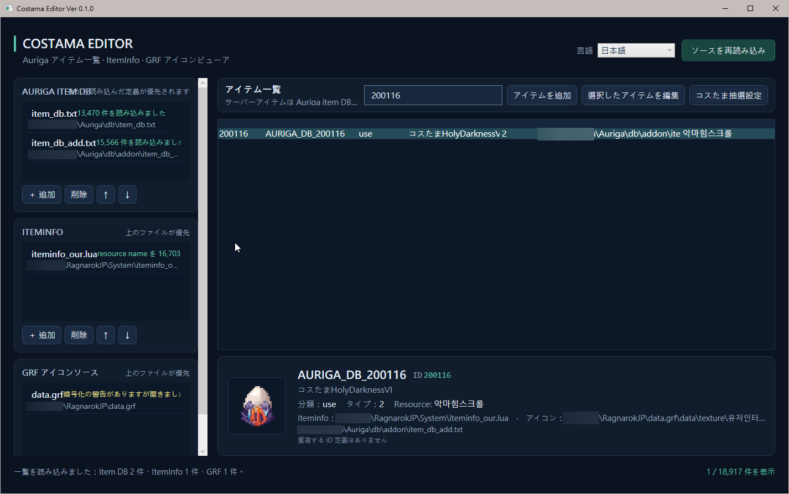

[English](README.md) | [繁體中文](README.zh-TW.md) | [日本語](README.ja.md)

# Costama Editor Ver 0.1.1

Costama Editor は、Auriga item DB の検索、ItemInfo／GRF によるアイテムアイコンの表示、アイテムの追加・編集、Costama の抽選範囲・賞品の重み・数量の設定を行う Windows デスクトップアプリです。単体で動作し、map-server は必要ありません。

画面は繁體中文、English、日本語に対応しています。選択した言語はすぐに反映され、次回起動時にも使われます。

## スクリーンショット



## クイックスタート

### 必要な環境

- Windows 10 以降
- ソースからの実行またはビルドには .NET 10 SDK が必要です

### ソースから実行

GitHub のプロジェクトページから ZIP をダウンロードして展開するか、リポジトリを clone します。プロジェクトのルートで PowerShell を開き、次を実行してください。

```powershell
dotnet run --project .\CostamaEditor.csproj
```

### 実行ファイルをビルド

```powershell
dotnet build .\CostamaEditor.csproj -c Release
```

ビルド後、`bin\Release\net10.0-windows\CostamaEditor.exe` を実行します。この framework-dependent 実行ファイルを使うには、Windows に .NET 10 Desktop Runtime が必要です。

## 初回の使い方

1. メイン画面で Auriga item DB、ItemInfo、GRF ファイルを追加します。複数ファイルをまとめて選択できます。
2. ゲームで読み込まれる順にリストを並べます。同じ ID の item DB 定義は後から読み込まれたものが優先されます。ItemInfo と GRF は上から順に検索し、最初に見つかったものを使います。
3. **ソースを再読み込み**を押して、アイテム一覧とアイコン索引を作成します。
4. 一覧でアイテムを検索して選択すると、下部にアイテム情報、定義元、アイコンの状態が表示されます。

ソース一覧と言語設定は、`CostamaEditor.exe` と同じフォルダーの `settings.json` に保存されます。初回起動時は既存の設定ファイルがあれば引き継ぎ、なければ初期設定を自動作成します。実行ファイルのフォルダーに書き込み権限が必要です。初期設定のパスが環境に合わない場合は、メイン画面でファイルを選び直してください。

## アイテムの検索と編集

- メイン画面の一覧では、ID、アイテム名、Jname、分類、ItemInfo resource name で検索できます。
- **アイテムを追加**を選ぶか、アイテムを選択して**選択したアイテムを編集**を押し、書き込み先の item DB を指定します。
- 新規アイテムでは ID、Name / Category、Jname、Type が必須です。既存アイテムの ID は変更できません。
- プレビューを作成し、書き込み先と内容を確認してから**バックアップして保存**を押します。ID が別の定義を上書きする場合は、事前に確認が必要です。
- 書き込み前に、ファイル名に `.bak.` とタイムスタンプを付けたバックアップを作成します。item DB は元の文字コードと改行を維持して編集します。

## Costama 抽選内容の設定

1. メイン一覧で Costama を選択し、**コスたま抽選設定**を押します。
2. 左側で ID または Jname を使って賞品を検索します。半角スペースで複数の検索語を区切ると、いずれかに一致するアイテムが表示されます。Ctrl または Shift で複数選択できます。
3. 右上に抽選範囲（1～16,777,216）を入力します。例：100、1,000。右側の賞品ごとに正の整数の重みを入力し、合計を抽選範囲に合わせます。数量も正の整数にしてください。
4. 右側の賞品を選択して Delete キーを押すか、**選択項目を削除**を押すと削除できます。残りの重みは元の比率に応じて抽選範囲まで再配分されます。抽選内容を空にすることもできます。空の場合、合計は 0 となり、保存時にそのアイテムの UseScript を消去します。
5. 書き込み先を選択し、**書き込みをプレビューして編集**を押します。アイテム編集画面で差分を確認してプレビューを作成し、**バックアップして保存**を押します。

既存の UseScript を対応する抽選形式として解析できない場合、元のスクリプトを保護するため抽選編集は無効になります。その場合は**選択したアイテムを編集**から直接編集してください。

既存の `rand(1,範囲)` の整数抽選範囲を引き継ぎ、入力した範囲を使って累積重みの UseScript を生成します。賞品分岐がすべて揃った形式は読み込めます。「ドロップなし」を表す空の分岐を含むスクリプトは、ドロップなしの確率を失わないよう、抽選内容として読み込みません。

## アイコンとデータの対応範囲

- ItemInfo は現在、テキスト形式の Lua／LUB を解析し、`identifiedResourceName` に対応する GRF アイコンを検索します。バイナリ LUB は非対応として表示し、元ファイルは変更しません。
- GRF アイコンの読み込みには GRF Editor のインストールが必要です。既定の Program Files フォルダーから `GRF.dll` と同じ場所にある `Utilities.dll` を検索します。必要な DLL がない場合も item DB の編集はできますが、GRF アイコンは読み込めません。
- 暗号化または互換性のない GRF からはアイコンを取得できない場合があります。メイン画面にソースの状態とエラー情報が表示されます。
- ItemInfo と GRF は読み取り専用です。選択した Auriga item DB への書き込みは、アイテム編集画面で保存を確定した場合に限られます。

## 依存関係と謝辞

### 依存関係

- **Microsoft .NET 10 / WPF**：アプリケーションのフレームワークです。ビルドには .NET 10 SDK、framework-dependent 実行ファイルの実行には .NET 10 Desktop Runtime が必要です。
- **NuGet**：追加の NuGet `PackageReference` はありません。
- **GRF Editor**：GRF アイコンの読み込み時に、インストール済みの `GRF.dll` と `Utilities.dll` を実行時に読み込みます。これらの DLL は本プロジェクトに含まれておらず、配布もしていません。[GRF Editor プロジェクト](https://github.com/Tokeiburu/GRFEditor)のライセンスと利用条件に従ってください。
- **Auriga**：実行時の依存関係ではありません。公開サーバーのソースコードとデータ形式のドキュメントを、item DB と Costama UseScript の参考として使用しています。

### 謝辞

GRF ファイル処理ツールを提供する [Tokeiburu と GRF Editor の貢献者](https://github.com/Tokeiburu/GRFEditor)、公開サーバーとデータ形式の参考資料を維持する [Auriga プロジェクトの貢献者](https://github.com/auriga/auriga)、Windows デスクトップフレームワークを提供する [Microsoft .NET／WPF チーム](https://learn.microsoft.com/en-us/dotnet/desktop/wpf/overview/)に感謝します。

## 著作権とライセンス

Copyright © 2026 Costama Editor contributors。Costama Editor 独自のコードとドキュメントは [MIT License](LICENSE) の下で公開しています。著作権表示と許諾表示を含めることで、使用、複製、改変、配布、サブライセンス、および販売ができます。

このライセンスは本プロジェクト独自のコードとドキュメントにのみ適用されます。サードパーティ製ソフトウェアとゲームデータには、それぞれのライセンスと利用条件が適用されます。本プロジェクトは GRF Editor の DLL を同梱・配布していません。

## よくある質問

**アイテム一覧が空です**

有効な Auriga item DB を追加し、**ソースを再読み込み**を押してください。

**アイテムのアイコンが表示されません**

ItemInfo に対象 ID の `identifiedResourceName` があること、GRF リストの順序が正しいこと、対応する GRF Editor がインストールされていることを確認してください。未読み込みまたは暗号化された GRF はソース状態に表示されます。

**抽選内容を適用できません**

書き込み先が選択されていること、抽選範囲が 1～16,777,216 の正の整数であること、各賞品の重みが正の整数で合計が抽選範囲と一致すること、数量も正の整数であることを確認してください。空の抽選内容を適用すると UseScript を消去できます。

**保存後に元のデータへ戻したい**

書き込み先と同じフォルダーにある、`.bak.` とタイムスタンプが付いたファイルを確認してください。復元する前にアプリを閉じ、現在のファイルも別途バックアップしてください。

## プロジェクト構成

```text
App.xaml                         WPF スタイルとアプリケーションリソース
MainWindow.xaml(.cs)             ソース設定、アイテム一覧、アイコン表示
CostamaPoolWindow.xaml(.cs)      抽選内容の検索・編集と UseScript プレビュー
ItemEditorWindow.xaml(.cs)       アイテム編集、差分プレビュー、保存
Data/                            item DB、ItemInfo、GRF の読み込みと item DB の書き込み
Models/                          アイテムとソースのデータモデル
Services/                        設定、言語、アイコン、UseScript のサービス
```
