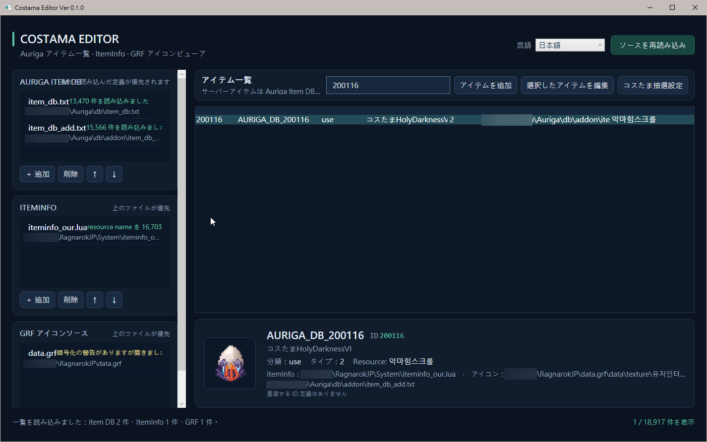

[English](README.md) | [繁體中文](README.zh-TW.md) | [日本語](README.ja.md)

# Costama Editor Ver 0.1.1

Costama Editor is a standalone Windows desktop app for browsing Auriga item DB files, viewing item icons from ItemInfo and GRF archives, adding or editing items, and configuring Costama roll ranges, reward weights, and quantities. It runs without map-server.

The interface is available in Traditional Chinese, English, and Japanese. The selected language is applied immediately and remembered.

## Screenshot



## Quick Start

### Requirements

- Windows 10 or later
- .NET 10 SDK to run from source or build the app

### Run from source

Download and extract the ZIP from the GitHub project page, or clone the repository. Open PowerShell in the project root and run:

```powershell
dotnet run --project .\CostamaEditor.csproj
```

### Build the executable

```powershell
dotnet build .\CostamaEditor.csproj -c Release
```

After the build, run `bin\Release\net10.0-windows\CostamaEditor.exe`. The framework-dependent executable requires the .NET 10 Desktop Runtime on Windows.

## First Use

1. Add the Auriga item DB, ItemInfo, and GRF files on the main screen. You can select multiple files at once.
2. Arrange the lists to match the game's load order. Later item DB definitions override earlier definitions with the same ID. ItemInfo and GRF sources are searched from top to bottom, using the first match.
3. Select **Reload sources** to build the item catalog and icon index.
4. Search for and select an item in the catalog. Its details, definition source, and icon status appear below.

The source lists and language preference are stored in `settings.json` beside `CostamaEditor.exe`. On first launch, the app reuses an existing settings file if available, or creates an empty settings file. Select your local item DB and other source files from the main screen. Make sure the executable folder is writable.

## Search and Edit Items

- Search the main catalog by ID, item name, Jname, category, or ItemInfo resource name.
- Select **New item**, or select an item and choose **Edit selected item**, then choose the target item DB.
- When adding an item, ID, Name / Category, Jname, and Type are required. The ID cannot be changed when editing an existing item.
- Generate a preview and check the target file and item data before choosing **Back up and save**. If the ID overrides another definition, confirm the warning first.
- A timestamped `.bak.` backup is created before writing. The item DB is edited while preserving its original encoding and line endings.

## Configure a Costama Pool

1. Select a Costama in the main catalog and choose **Costama pool**.
2. Search for prizes by ID or Jname. Separate multiple search terms with half-width spaces to show items matching any term. Use Ctrl or Shift to select multiple items.
3. Enter a roll range in the upper-right field (1–16,777,216), such as 100 or 1,000. Enter a positive integer weight for each prize; the weights must add up to the roll range. Quantities must also be positive integers.
4. Select one or more prizes on the right and press Delete or choose **Remove selected**. The remaining weights are redistributed proportionally to the roll range. The pool can be emptied; an empty pool has a total of 0 and clears that item's UseScript when saved.
5. Choose the target file and select **Preview and edit write**. Review the changes in the item editor, generate a preview, then choose **Back up and save**.

If an existing UseScript cannot be parsed as a supported pool format, pool editing is disabled to protect the original script. Use **Edit selected item** to edit it directly.

The pool editor preserves the integer range in existing `rand(1,range)` scripts and generates cumulative weights using the entered range. It can read complete prize branches. Scripts with an empty “no drop” branch are not imported as complete pools, so the no-drop chance is not lost.

## Icons and Data Support

- ItemInfo parsing currently supports text Lua / LUB files and maps `identifiedResourceName` values to GRF icons. Binary LUB files are marked unsupported and are not modified.
- GRF icon loading requires GRF Editor to be installed. The app looks for `GRF.dll` and the adjacent `Utilities.dll` in the default Program Files locations. Item DB editing remains available if these components are missing, but GRF icons cannot be loaded.
- Encrypted or incompatible GRF archives may not provide icons. The main screen shows source status and error details.
- The app only reads ItemInfo and GRF files. It writes to the selected Auriga item DB only after you confirm saving in the item editor.

## Dependencies and Thanks

### Dependencies

- **Microsoft .NET 10 / WPF**: Application framework. Building requires the .NET 10 SDK; running the framework-dependent executable requires the .NET 10 Desktop Runtime.
- **NuGet**: The project currently has no additional NuGet `PackageReference` dependencies.
- **GRF Editor**: At runtime, the app loads `GRF.dll` and `Utilities.dll` from an installed copy of GRF Editor to read GRF icons. These DLLs are not included or distributed with this project. Follow the [GRF Editor project](https://github.com/Tokeiburu/GRFEditor) license and usage terms.
- **Auriga**: Auriga is not a runtime dependency. Its public server source code and data format documentation are used as references for item DB and Costama UseScript formats.

### Thanks

Thanks to [Tokeiburu and the GRF Editor contributors](https://github.com/Tokeiburu/GRFEditor) for the GRF file tools, the [Auriga project contributors](https://github.com/auriga/auriga) for maintaining public server source code and data format references, and the [Microsoft .NET / WPF team](https://learn.microsoft.com/en-us/dotnet/desktop/wpf/overview/) for the Windows desktop framework.

## Copyright and License

Copyright © 2026 Costama Editor contributors. Costama Editor's original code and documentation are licensed under the [MIT License](LICENSE). You may use, copy, modify, distribute, sublicense, and sell copies, provided that the copyright and permission notices are included.

This license applies to this project's own code and documentation. Third-party software and game data remain subject to their respective licenses and terms; GRF Editor DLLs are not included or distributed with this project.

## FAQ

**The catalog is empty**

Make sure a valid Auriga item DB is listed, then select **Reload sources**.

**An item has no icon**

Check that ItemInfo has an `identifiedResourceName` for the item ID, the GRF list is ordered correctly, and a compatible GRF Editor installation is available. Unloaded or encrypted GRF archives are shown in the source status.

**The pool cannot be applied**

Make sure a target file is selected, the roll range is a positive integer from 1 to 16,777,216, every prize has a positive integer weight, the weights add up to the roll range, and all quantities are positive integers. An empty pool can be applied to clear UseScript.

**Restore the original data after saving**

Look for the timestamped `.bak.` file next to the target. Close the app and make your own backup of the current file before restoring it.

## Project Structure

```text
App.xaml                         WPF styles and application resources
MainWindow.xaml(.cs)             Source setup, item catalog, and icon preview
CostamaPoolWindow.xaml(.cs)      Pool search, editing, and UseScript preview
ItemEditorWindow.xaml(.cs)       Item editing, diff preview, and saving
Data/                            item DB, ItemInfo, and GRF readers; item DB writer
Models/                          Item and source data models
Services/                        Settings, localization, icon, and UseScript services
```
