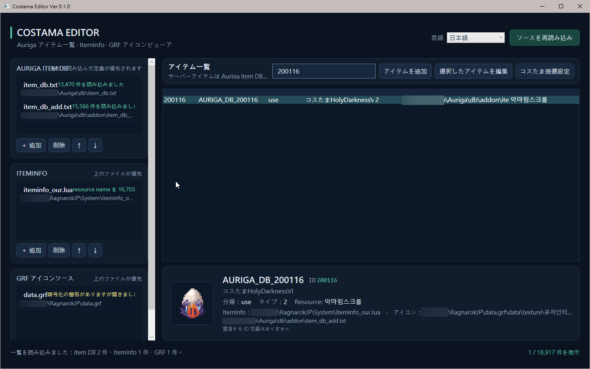
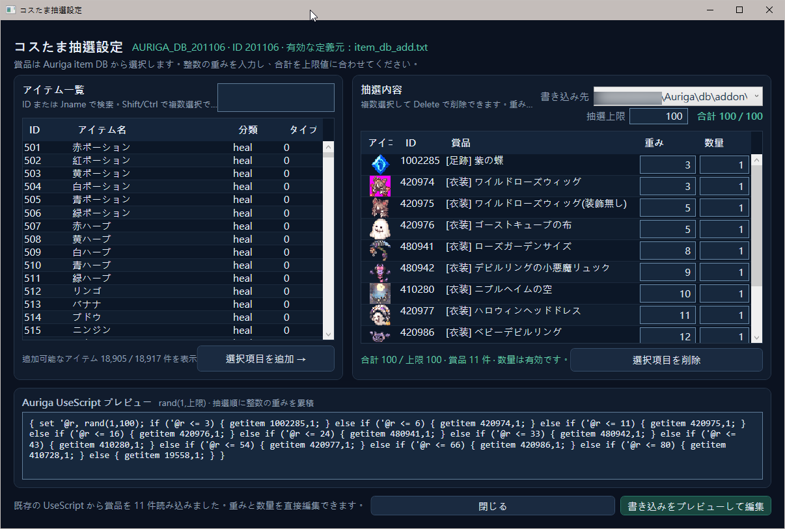

[English](README.md) | [繁體中文](README.zh-TW.md) | [日本語](README.ja.md)

# Costama Editor Ver 0.1.1

Costama Editor 是 Windows 桌面工具，用來搜尋 Auriga item DB、檢視 ItemInfo／GRF 道具圖示、新增或編輯道具，以及設定 Costama 抽選上限、獎品權重和數量。這是獨立的本機程式，執行時不需要啟動 map-server。

介面支援繁體中文、English 和日本語；語言選擇會立即套用並記住。

## 操作畫面





## 快速開始

### 需求

- Windows 10 或更新版本
- .NET 10 SDK（從原始碼執行或建置時需要）

### 從原始碼執行

在 GitHub 專案頁面下載 ZIP 並解壓縮，或 clone 專案；在專案根目錄開啟 PowerShell，執行：

```powershell
dotnet run --project .\CostamaEditor.csproj
```

### 建置執行檔

```powershell
dotnet build .\CostamaEditor.csproj -c Release
```

建置完成後，執行 `bin\Release\net10.0-windows\CostamaEditor.exe`。此執行檔需要 Windows 上的 .NET 10 Desktop Runtime。

## 第一次使用

1. 在主畫面分別加入 Auriga item DB、ItemInfo 和 GRF 檔案。檔案可以多選加入。
2. 依照遊戲實際載入順序調整清單：item DB 後載入的定義會覆蓋前面的同 ID 定義；ItemInfo 和 GRF 則由上往下採用第一個命中。
3. 按「重新載入來源」建立道具目錄與圖示索引。
4. 在目錄搜尋道具並選取；下方會顯示道具資訊、定義來源和圖示狀態。

來源清單和語言偏好會保存在 `CostamaEditor.exe` 同一個資料夾的 `settings.json`。首次啟動時會沿用既有設定檔（若存在），否則建立空的設定檔。請在主畫面選擇本機 item DB 等來源檔案，並確保執行檔資料夾可寫入。

## 搜尋與編輯道具

- 主畫面目錄可搜尋 ID、道具名稱、Jname、分類及 ItemInfo resource name。
- 按「新增道具」或選取道具後按「編輯選取項目」，指定要寫入的 item DB。
- 新增道具時，ID、Name／Category、Jname 和 Type 為必填；編輯既有道具時 ID 不可修改。
- 先產生預覽並確認目標檔案與資料，再按「備份並儲存」。若 ID 會覆蓋其他定義，需先確認提示。
- 寫入前會建立目標檔案備份，檔名會附加 `.bak.` 和時間戳記。Item DB 以原始編碼與換行方式修改。

## 設定 Costama 獎池

1. 在主目錄選取 Costama，按「Costama 獎池」。
2. 左側搜尋獎品，可輸入 ID 或 Jname；用半形空白分隔多個搜尋詞時，符合任一詞的道具會列出。使用 Ctrl 或 Shift 可多選。
3. 在右上輸入抽選上限（1–16,777,216），例如 100 或 1,000；右側獎品欄輸入正整數權重，總和需等於上限。數量也需為正整數。
4. 選取右側獎品後按 Delete 或「移除選取」刪除；剩餘權重會按原比例重分配至上限。獎池可以清空；空池總和為 0，儲存時會移除該道具的 UseScript。
5. 選擇寫入目標，按「預覽寫入並編輯」，在道具編輯器檢查差異、產生預覽，再按「備份並儲存」完成寫入。

若既有 UseScript 無法辨識為支援的獎池格式，工具會停用獎池覆寫，避免破壞原腳本；請改用「編輯選取項目」處理。

獎池編輯器會保留既有 UseScript 的 `rand(1,上限)` 整數抽選範圍，並以輸入的上限產生累積權重腳本。完整獎品分支可讀取；含空的「不掉落」分支不會當成完整獎池匯入，以免遺失該機率。

## 圖示與資料支援

- ItemInfo 目前解析文字型 Lua／LUB，依 `identifiedResourceName` 對應 GRF 圖示。二進位 LUB 會標示為不支援，不會修改原始檔案。
- GRF 圖示讀取需要 GRF Editor。程式會自動搜尋 Program Files 的預設位置；若安裝在其他位置，可在 GRF 圖示來源中選擇 `GRF.dll`，且同一資料夾需有 `Utilities.dll`。自訂路徑會保存在 `settings.json`。
- 加密或不相容的 GRF 可能無法提供圖示；主畫面會顯示來源狀態與錯誤資訊。
- 工具只讀取 ItemInfo 和 GRF；只有在道具編輯器確認儲存後，才會寫入指定的 Auriga item DB。

## Dependencies 與致謝

### Dependencies

- **Microsoft .NET 10 / WPF**：應用程式框架。建置需使用 .NET 10 SDK；執行 framework-dependent 執行檔需安裝 .NET 10 Desktop Runtime。
- **NuGet**：目前沒有額外的 NuGet `PackageReference`。
- **GRF Editor**：讀取 GRF 圖示時，執行階段會載入已安裝版本中的 `GRF.dll` 和 `Utilities.dll`。本專案不包含或散佈這些 DLL；請依 [GRF Editor 專案](https://github.com/Tokeiburu/GRFEditor)的授權與規範使用。
- **Auriga**：不是執行依賴；其公開伺服器原始碼與資料格式文件用於參考 item DB 和 Costama UseScript 格式。

### 致謝

感謝 [Tokeiburu 與 GRF Editor 貢獻者](https://github.com/Tokeiburu/GRFEditor)提供 GRF 檔案處理工具，感謝 [Auriga 專案貢獻者](https://github.com/auriga/auriga)維護公開伺服器與資料格式參考，也感謝 [Microsoft .NET／WPF 團隊](https://learn.microsoft.com/en-us/dotnet/desktop/wpf/overview/)提供 Windows 桌面應用程式框架。

## 著作權與授權

Copyright © 2026 Costama Editor contributors。Costama Editor 自有的程式碼與文件採用 [MIT 授權](LICENSE)。你可以使用、複製、修改、散布、再授權或販售副本，但須一併保留著作權與授權聲明。

此授權僅適用於本專案自有的程式碼與文件。第三方軟體及遊戲資料仍受各自授權與使用條款規範；本專案不包含或散布 GRF Editor DLL。

## 常見問題

**目錄沒有道具**

確認已加入有效的 Auriga item DB，然後按「重新載入來源」。

**道具沒有圖示**

確認 ItemInfo 有該 ID 的 `identifiedResourceName`、GRF 清單順序正確，並已安裝相容的 GRF Editor。未載入或加密的 GRF 會顯示在來源狀態。

**獎池按鈕無法套用**

確認已選擇寫入目標，抽選上限為 1–16,777,216 的正整數、各獎品權重為正整數且總和等於上限，數量也都是正整數。空獎池可套用以清除 UseScript。

**儲存後要還原原始資料**

在寫入目標旁尋找 `.bak.` 時間戳記備份檔；還原前請先關閉工具並自行備份目前檔案。

## 專案結構

```text
App.xaml                         WPF 樣式與應用程式資源
MainWindow.xaml(.cs)             來源設定、道具目錄與圖示預覽
CostamaPoolWindow.xaml(.cs)      獎池搜尋、編輯與 UseScript 預覽
ItemEditorWindow.xaml(.cs)       道具資料編輯、差異預覽與儲存
Data/                            item DB、ItemInfo、GRF 讀取與 item DB 寫入
Models/                          道具與來源資料模型
Services/                        設定、語系、圖示和 UseScript 服務
```
